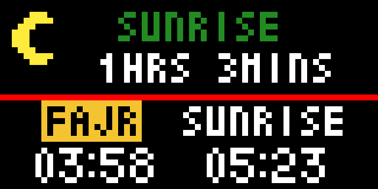

# Islamic Prayer Times

This app displays the prayer times for today's date based on the user location and the method of prayer time calculation. The location, timezone and prayer time calculation method are configurable in Tidbyt app based on the user input.

## Color Scheme

By default, the day's prayer times are shown in the lower half of the screen and colored in white. The current prayer name is highlighted in yellow in the lower half of the screen. The upper half of the screen shows the remaining time till the next prayer and its colored in green. These colors can be changed in the app's settings.

## Day Icon

The Sun/Moon icon in the top left is indicating the current time of the day either Day or Night.

## Configuration

The Tidbyt app lets you set the location that prayer times will calculated based on it. Also you can set the method of the prayer times calculation, you can pick it from dropdown list.

You can also set:

- **Asr Calculation:** Standard (Shafi'i, Maliki, Hanbali) or Hanafi.
- **Single Page:** list the five daily prayers on one screen instead of cycling through three screens. The current prayer is highlighted and the next prayer's name is shown in the next prayer color. Sunrise and the countdown are left out so everything fits.
- **Cycle Rate:** how long each screen of prayer times is shown, from 2 to 10 seconds. Not used by the single page layout.
- **12 Hour Clock:** show prayer times in 12 hour format, which is the default, or turn it off for 24 hour format.
- **Time Offset:** add or remove up to 30 minutes from all prayer times, for example to match a local mosque.
- **Colors:** choose the color of each part of the display.

## Disclaimer

This app shows the prayer times based on [Adhan API's](https://aladhan.com/).

It was written as a fun exercise because I often need to check prayer times.

This version was modified by tmuhamma from the original app by EslamMoh in [tidbyt/community](https://github.com/tidbyt/community), and is licensed under the [Apache License 2.0](https://www.apache.org/licenses/LICENSE-2.0).

## Contact
